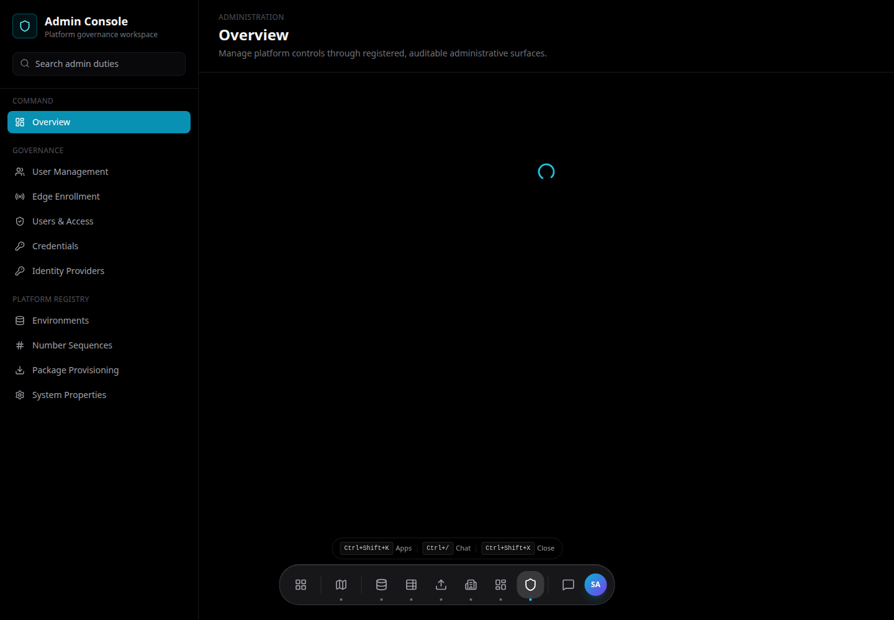
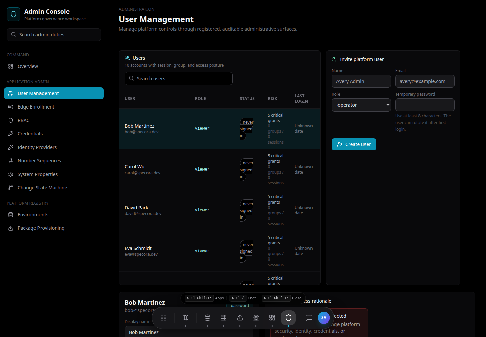
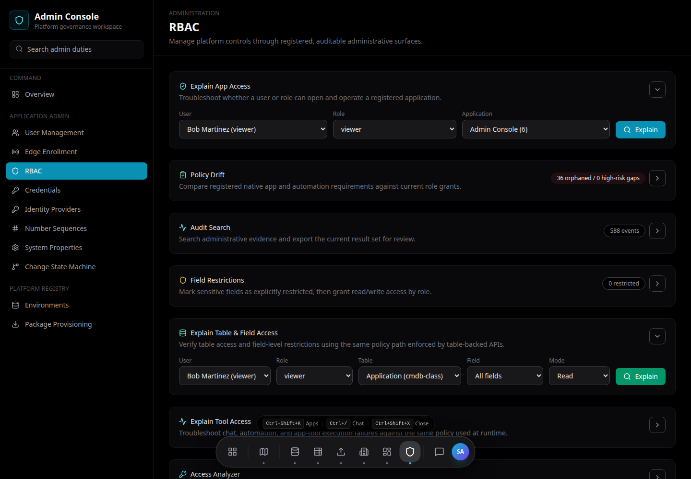

# Admin Guide

Admin Console centralizes platform governance. Access depends on role and permissions.

## Overview

Use **Admin Console** to manage:

- Users.
- RBAC.
- Credentials.
- Identity providers.
- Edge enrollment.
- Environments.
- Number sequences.
- System properties.
- Change state machine.
- Package provisioning.

## User Management

Use User Management to:

- Search users.
- Review role and status.
- Edit display name and role where allowed.
- Disable or restore access where supported.
- Analyze user access and graph context.

User-like CI fields such as assigned user, owner, supported by, and managed by should reference the platform User table rather than store free text.

## RBAC

Use RBAC to manage platform permissions.

RBAC controls:

- App visibility.
- API read/write access.
- Table access.
- Admin actions.
- Security-sensitive operations.

Keep RBAC changes small and auditable.

## Credentials

Use Credentials to manage reusable external references.

Credential scopes include:

- Discovery.
- Platform.
- Integration-specific scopes.

Credential references are generated by the platform. Users provide display metadata and secret values, but should not hand-craft internal credential reference IDs.

## Edge Enrollment

Use Edge Enrollment to:

- Create enrollment tokens.
- Copy newly created tokens immediately.
- Revoke exposed or unused tokens.
- View enrolled collectors.
- Delete collector registrations when needed.
- Review heartbeat, health, version, capabilities, and queue depth.

Treat enrollment tokens as sensitive. Replace any token pasted into chat, logs, or tickets.

## Runtime Configuration

Admin Console exposes the public job signing key/keyring and runtime configuration metadata used by edge collectors.

Platform publishes:

- Public signing keys.
- Collector manifests.
- Capability policies.

Edge operators bootstrap runtime configuration locally.

## Environments

Use Environments to manage environment reference data.

Recommended fields:

- Name.
- Code.
- Active status.
- Sort order.
- Production-like flag.

Use this instead of hard-coded DB enums so organizations can model local naming standards.

## Number Sequences

Use Number Sequences to manage generated identifiers for platform records.

Examples:

- Incident numbers.
- Change numbers.
- Request numbers.
- Asset numbers.

## System Properties

Use System Properties for controlled platform configuration.

Only store non-secret values here. Secrets belong in environment variables or credential storage.

## Identity Providers

Use Identity Providers to configure enterprise authentication providers when available.

Typical settings include:

- Provider name.
- Issuer or metadata endpoint.
- Client identifier.
- Active status.

## Change State Machine

Use Change State Machine to govern change status transitions.

State-machine configuration should match the organization approval model.

## Package Provisioning

Use Package Provisioning to review app/package availability and installation status.

Related:

- [Application Reference](../apps/README.md)
- [Operations Guide](../operations/README.md)
- [Discovery and Edge Collectors](../workflows/discovery.md)
