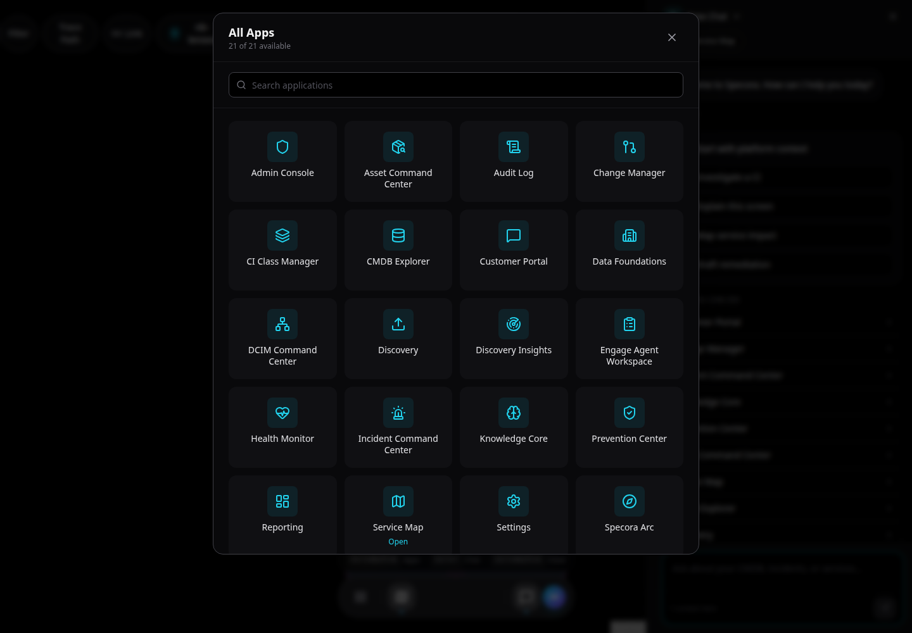

# Global Chat and AI Assistance

Specora chat is a platform-aware assistant. It can answer questions, use context from the active screen, and return action links that open platform apps.

## Context

Chat can use:

- Active app and screen.
- Selected CI.
- Service map root.
- App-provided screen context.
- Tool results from CMDB, relationships, and application APIs.

Context chips appear near the top of the chat panel. Remove a chip if you do not want it included.

## Common Prompts

Use prompts like:

- `Help me investigate the selected CI.`
- `Summarize the top risks and recommended next actions.`
- `Open the service map for this CI.`
- `Find risky CIs in the CMDB.`
- `Review this table for data quality gaps.`

## Tool Links

Assistant responses may include action buttons such as:

- **Open CI**
- **Service Map**
- **Open Search in CMDB Explorer**
- **Edit in Tables**

Tool links are preferred over vague instructions because they take you directly to the relevant app context.

## Working Steps

When chat uses tools, it shows working steps such as:

- Preparing platform context.
- Asking assistant.
- Running search or detail tools.

If chat cannot fetch more data, it should summarize from the available context and identify limitations.

## Safe Use

Chat is useful for investigation, summarization, and navigation. Do not treat generated text as final approval for production-impacting work. Validate high-risk changes in the appropriate application and approval workflow.

Chat is permission-aware. Users only see and execute tools for apps and data domains they can access. A basic authenticated user can still ask for help, use Customer Portal guidance, and update profile/settings context, but cannot retrieve CMDB, Admin, Arc, reporting, discovery, or ITSM operational data through chat.

Related guides:

- [CMDB and Service Mapping](workflows/cmdb-and-service-mapping.md)
- [ITSM Workflows](workflows/itsm.md)
- [Admin Guide](admin/README.md)
