# Application Reference

This reference covers every built-in Specora app. Apps are permission-aware; users only see apps allowed by their role.

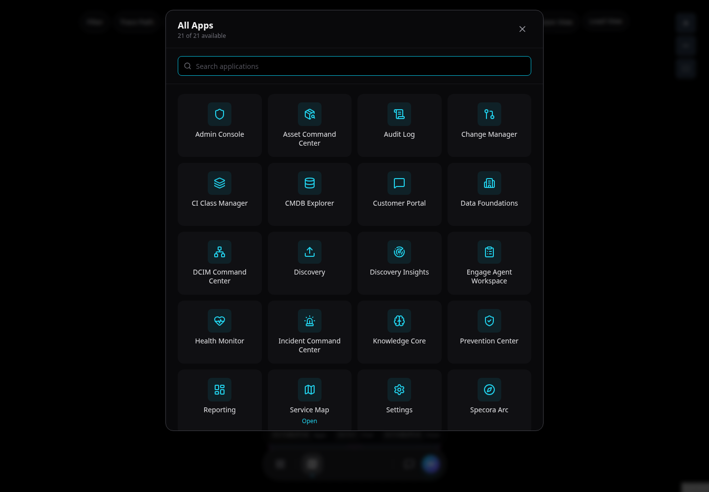

## Platform Apps

### Service Map

Visualizes CI relationships as an interactive graph.

Use it to:

- Open topology for a selected CI.
- Add, change, or remove relationships.
- Understand upstream and downstream impact.
- Launch CI detail review from graph context.

Screenshot: 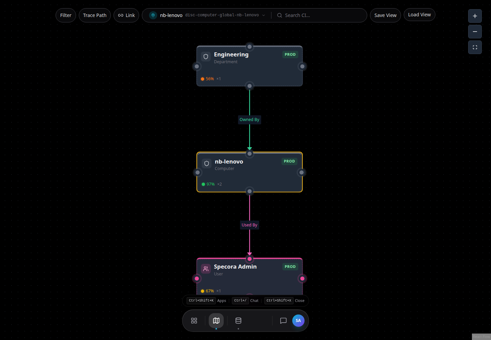

Related: [CMDB and Service Mapping](../workflows/cmdb-and-service-mapping.md)

### CMDB Explorer

Searches, filters, and investigates Configuration Items.

Use it to:

- Search CIs by name, class, or environment.
- Review health, quality signals, relationships, and attributes.
- Open Service Map or Tables for a CI.
- Identify stale, incomplete, orphaned, or risky CIs.

Screenshot: 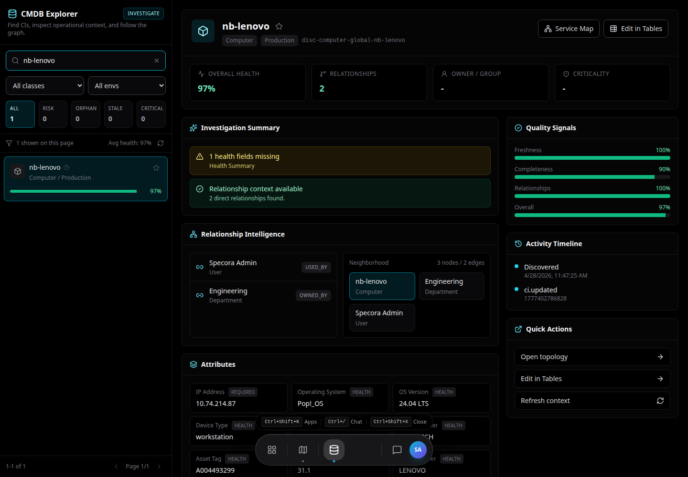

Related: [CMDB and Service Mapping](../workflows/cmdb-and-service-mapping.md)

### Tables

Provides RBAC-aware table browsing and record maintenance.

Use it to:

- Browse CMDB class tables and platform tables.
- Create, edit, delete, import, export, and bulk update records.
- Use typeahead reference fields.
- Save table views and configure columns.
- Review validation and stewardship signals.

Screenshot: 

Related: [Tables and Data Foundations](../workflows/tables-and-data-foundations.md)

### Discovery

Manages discovery sources, samples, AI-assisted mapping, pipeline preview, and commit.

Use it to:

- Create discovery sources.
- Select source datasets and runs.
- Build and edit AI-directed pipeline nodes.
- Preview staged create/update/link decisions.
- Commit approved records into the CMDB.

Screenshot: 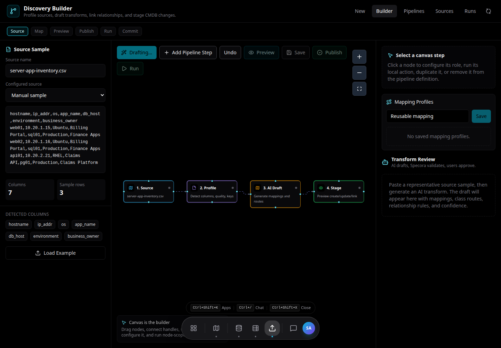

Related: [Discovery and Edge Collectors](../workflows/discovery.md)

### Data Foundations

Governs foundation data and relationship type registries.

Use it to:

- Review CSDM foundation readiness.
- Manage relationship types.
- Inspect governed data quality for foundational records.

Screenshot: 

Related: [Tables and Data Foundations](../workflows/tables-and-data-foundations.md)

### Reporting

Provides operational KPI dashboards and governed report previews.

Use it to:

- Review executive and operational indicators.
- Preview reporting datasets.
- Export governed report data.
- Support BI contract handoff.

Screenshot: 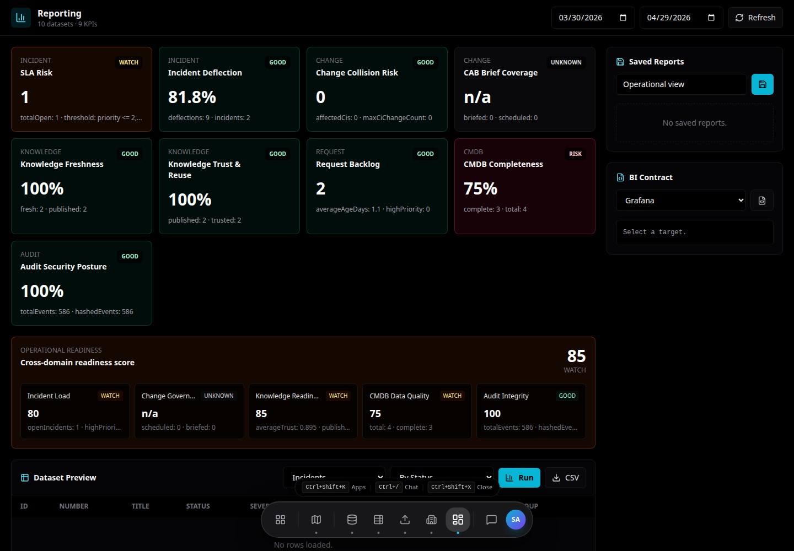

Related: [Reporting](../workflows/reporting.md)

### Specora Arc

Manages platform applications and the app ecosystem.

Use it to:

- Browse installed and available apps.
- Review app metadata and capabilities.
- Manage app install status when provisioning is enabled.

Screenshot: 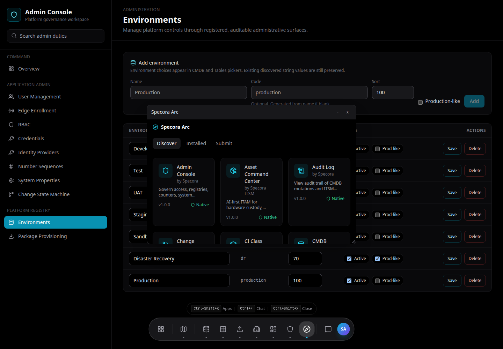

## Administration Apps

### Admin Console

Central administration workspace for access, platform registries, and operational configuration.

Use it to manage:

- Users.
- RBAC.
- Credentials.
- Edge enrollment.
- Environments.
- Identity providers.
- Number sequences.
- System properties.
- Change state machine.
- Package provisioning.

Screenshot: 

Related: [Admin Guide](../admin/README.md)

### CI Class Manager

Defines CI classes, class attributes, reconciliation keys, health requirements, display fields, and reference behavior.

Use it to:

- Create and edit CI classes.
- Manage class attributes.
- Mark mandatory, key, health, enum, and reference fields.
- Configure display and secondary display fields.

Screenshot: 

Related: [Tables and Data Foundations](../workflows/tables-and-data-foundations.md)

### Settings

User profile and preferences window.

Use it to:

- Change theme.
- Review account details.
- Adjust supported user preferences.

Screenshot: 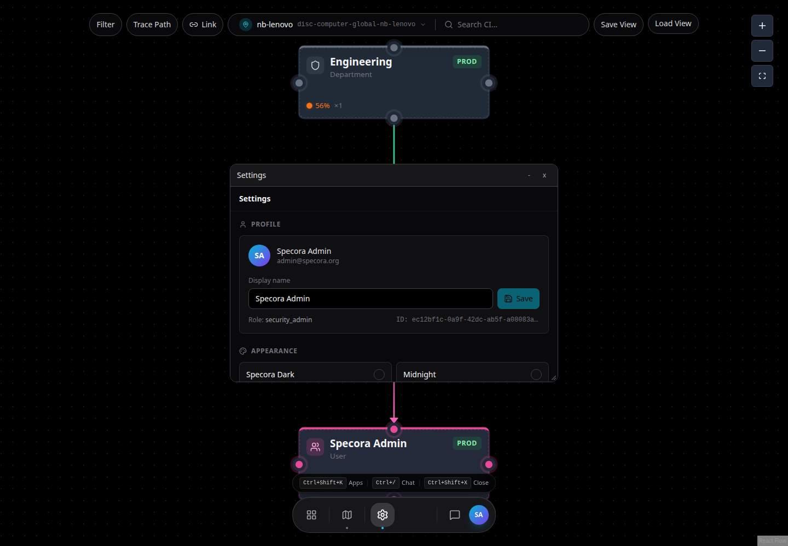

Related: [Workspace and Navigation](../workspace.md)

## ITSM Apps

### Incident Command Center

AI-first incident triage and command workspace.

Use it to:

- Review active incidents.
- Triage severity and affected services.
- Draft remediation guidance.
- Track command context.

Screenshot: 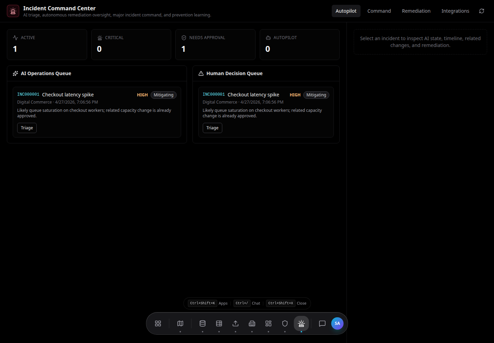

Related: [ITSM Workflows](../workflows/itsm.md)

### Change Manager

Change request planning and approval workspace.

Use it to:

- Create and review change requests.
- Track approval readiness.
- Prepare CAB context.
- Use state-machine governed status changes.

Screenshot: 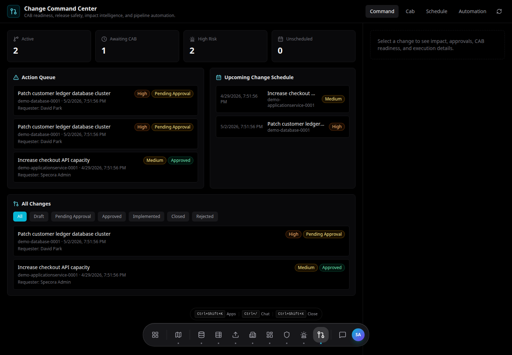

Related: [ITSM Workflows](../workflows/itsm.md)

### Knowledge Core

Governed operational knowledge workspace.

Use it to:

- Review knowledge gaps.
- Draft and publish knowledge.
- Evaluate feedback and confidence.
- Connect knowledge to incidents, changes, and services.

Screenshot: 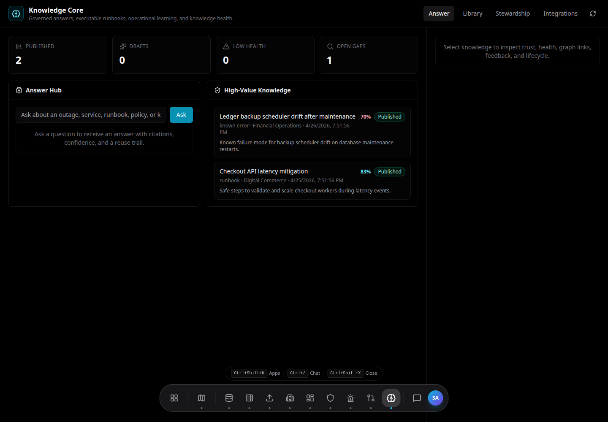

Related: [ITSM Workflows](../workflows/itsm.md)

### Prevention Center

Reliability prevention and corrective-action workspace.

Use it to:

- Detect recurring issues.
- Track known errors.
- Propose corrective actions.
- Measure prevention progress.

Screenshot: 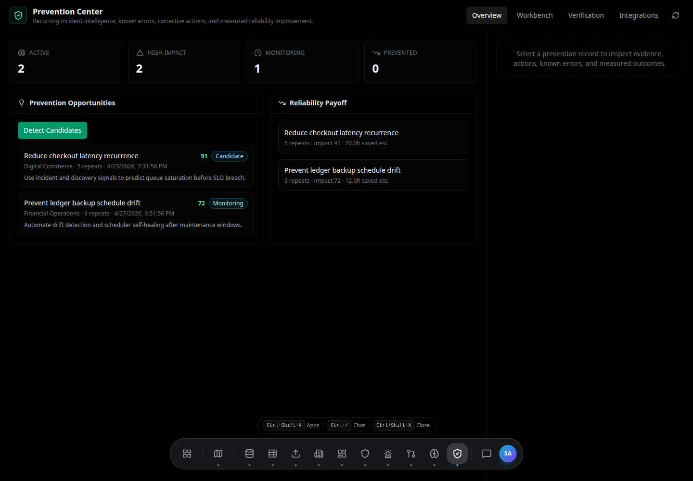

Related: [ITSM Workflows](../workflows/itsm.md)

### Asset Command Center

IT asset and software asset management workspace.

Use it to:

- Review asset exceptions.
- Reconcile software entitlement risk.
- Inspect contracts and custody signals.
- Track asset financial and compliance context.

Screenshot: 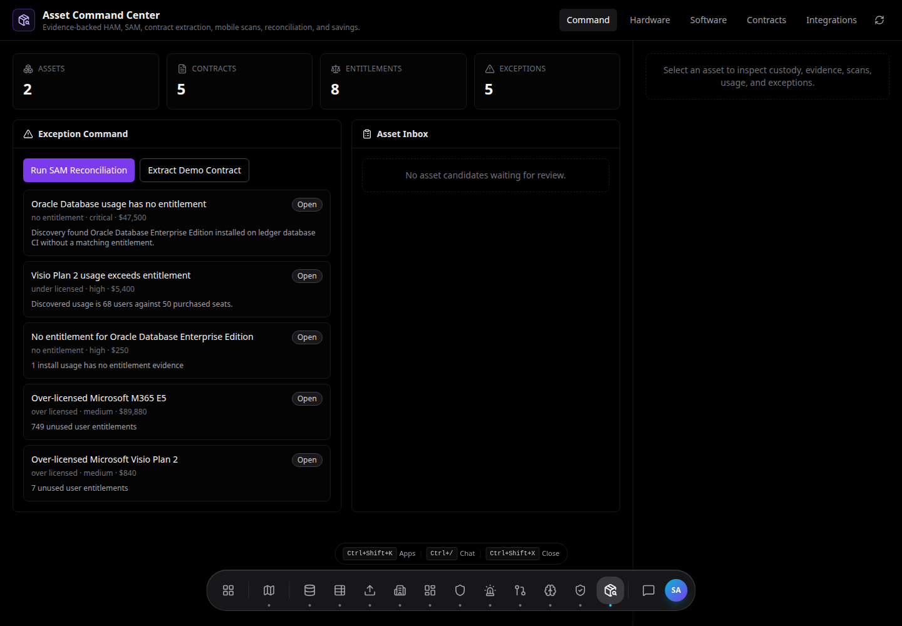

Related: [ITSM Workflows](../workflows/itsm.md)

### Customer Portal

Self-service front door for requesters.

Use it to:

- Search knowledge.
- Submit catalog requests.
- Review request status.
- Request support handoff.

Screenshot: 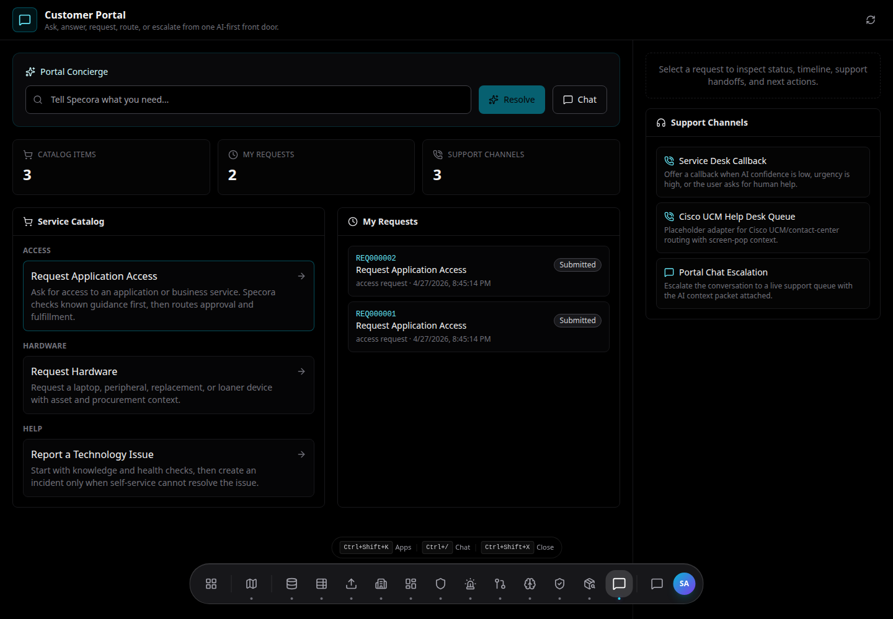

Related: [ITSM Workflows](../workflows/itsm.md)

### Engage Agent Workspace

Agent workspace for catalog request fulfillment and requester updates.

Use it to:

- Review request queues.
- Draft agent briefs.
- Draft requester updates.
- Link requests to knowledge and operational context.

Screenshot: 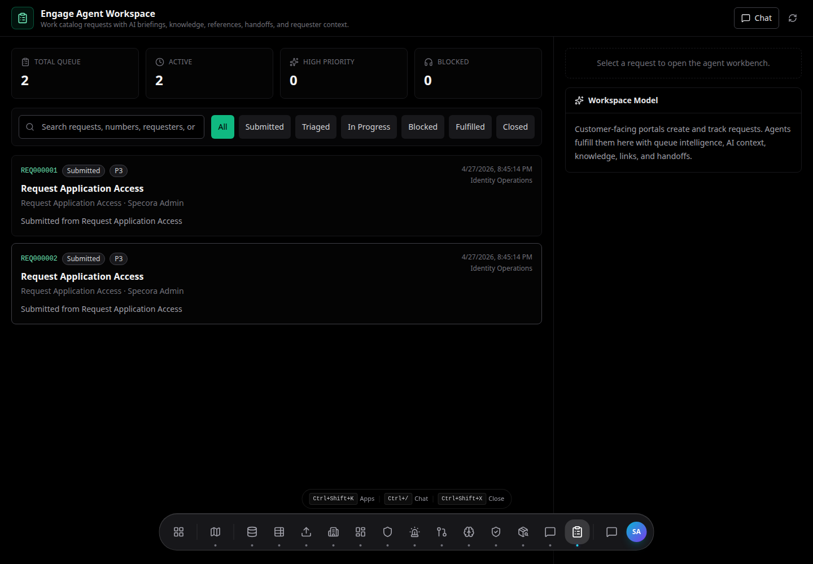

Related: [ITSM Workflows](../workflows/itsm.md)

## Visibility and Governance Apps

### Discovery Insights

Discovery coverage and scan recommendation workspace.

Use it to:

- Review source coverage.
- Identify stale or failed discovery areas.
- Suggest next scans or collection improvements.

Screenshot: 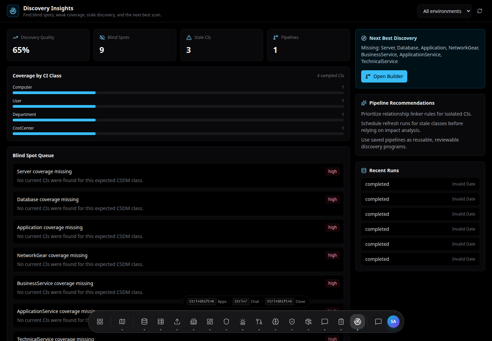

### Health Monitor

CI health monitoring and anomaly review workspace.

Use it to:

- Review CI health trends.
- Detect low-quality or degraded records.
- Prioritize remediation.

Screenshot: 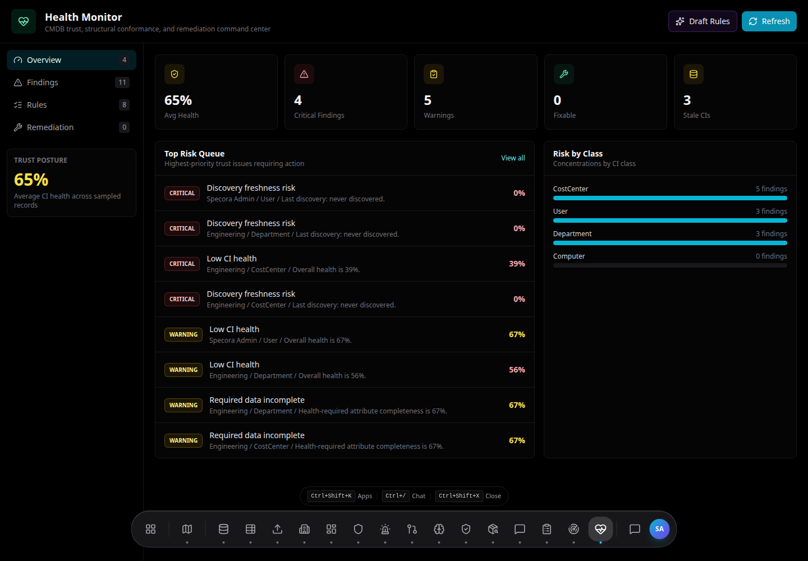

### DCIM Command Center

Premium IT visibility app for data center facility topology.

Use it to:

- Review racks, power, cooling, and facility risk.
- Simulate facility impact.
- Correlate facility events.

Screenshot: 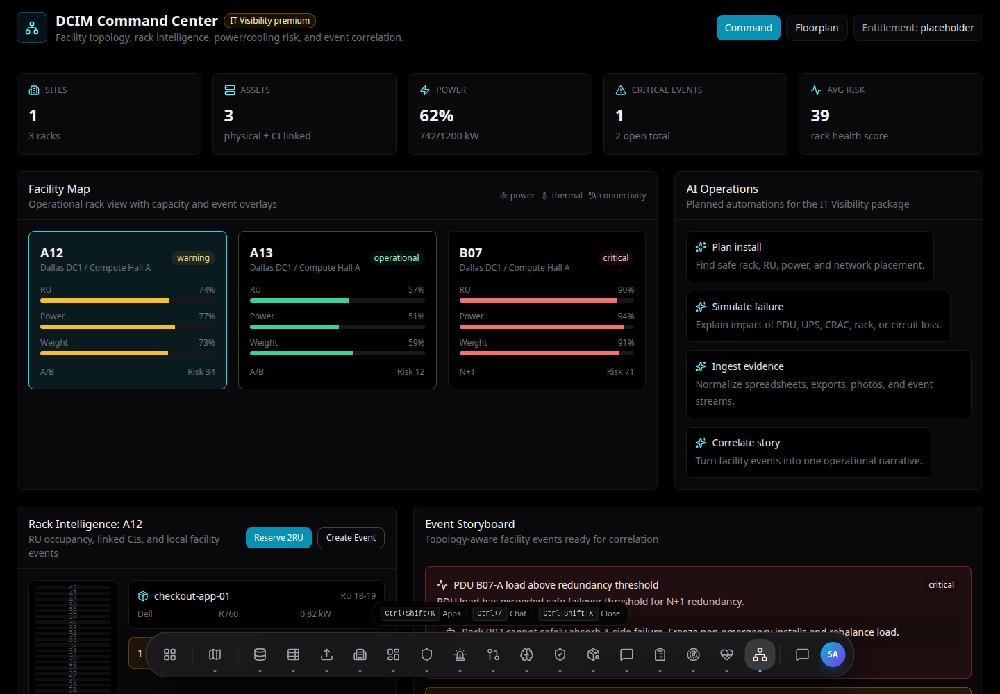

### Audit Log

Audit trail for CMDB and platform mutations.

Use it to:

- Review who changed what and when.
- Inspect old and new values.
- Support governance, troubleshooting, and compliance review.

Screenshot: 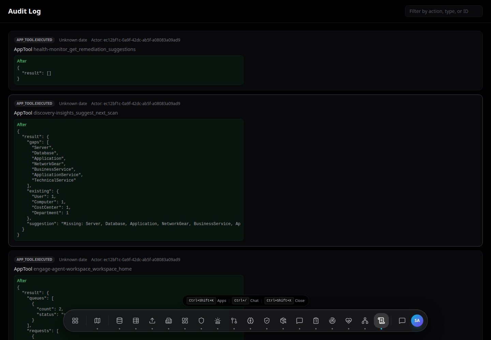

## Developer Example

### Hello World

Example app used for app ecosystem validation and demos. It is not intended as an operational production app.
