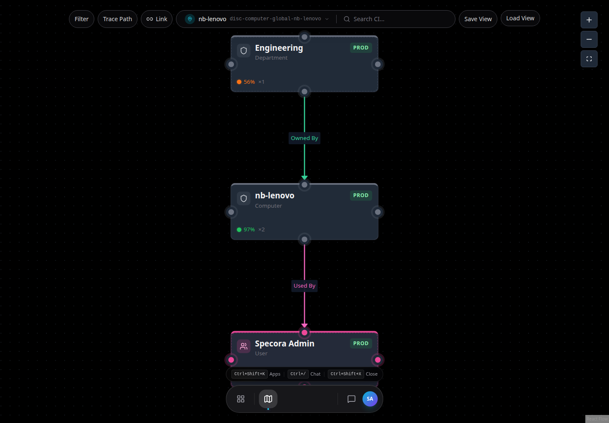

# Getting Started

This guide gets a new user from sign-in to a useful first investigation.

## Sign In

1. Open the Specora web URL for your environment.
2. Enter your platform account email and password.
3. Select **Sign In**.

If single sign-on is configured, use **SSO** instead of password sign-in.

## First Screen

After sign-in, Specora opens the platform workspace. The workspace contains:

- The app dock at the bottom of the screen.
- Canvas apps, such as CMDB Explorer, Tables, Discovery, and Service Map.
- Window apps, such as Settings and CI Class Manager.
- The global chat panel, opened with `Ctrl+/` or `Cmd+/`.
- The app launcher, opened with `Ctrl+Shift+K` or `Cmd+Shift+K`.

See [Workspace and Navigation](workspace.md) for full navigation details.

## Recommended Demo Path

Use this path when introducing Specora to a new user.

1. Open **CMDB Explorer**.
2. Search for a discovered CI, for example `nb-lenovo`.
3. Review health, required fields, relationships, attributes, and activity.
4. Open **Service Map** from the CI detail page.
5. Inspect upstream and downstream relationships.
6. Open **Tables** from the CI detail page and edit governed data.
7. Open **Discovery** and review sources, pipelines, and recent runs.
8. Open global chat and ask: `Help me investigate nb-lenovo and summarize risk, relationships, and recommended next steps.`

## Roles

Available apps and actions depend on your role.

- **Authenticated user with no platform role** - use Settings and Customer Portal self-service. Operational apps and operational chat tools are hidden.
- **Viewer** - read platform data and use basic workspace features.
- **Operator** - create and update operational records.
- **Admin** - manage CMDB data, discovery, users, and platform configuration.
- **Security Admin** - manage access, RBAC, audit, and security-sensitive administration.

Specora Arc is restricted to Admin and Security Admin users. Customer Portal is available to every authenticated user.

## Where To Go Next

- Investigate CIs: [CMDB and Service Mapping](workflows/cmdb-and-service-mapping.md)
- Import or discover data: [Discovery and Edge Collectors](workflows/discovery.md)
- Maintain records: [Tables and Data Foundations](workflows/tables-and-data-foundations.md)
- Administer the platform: [Admin Guide](admin/README.md)
