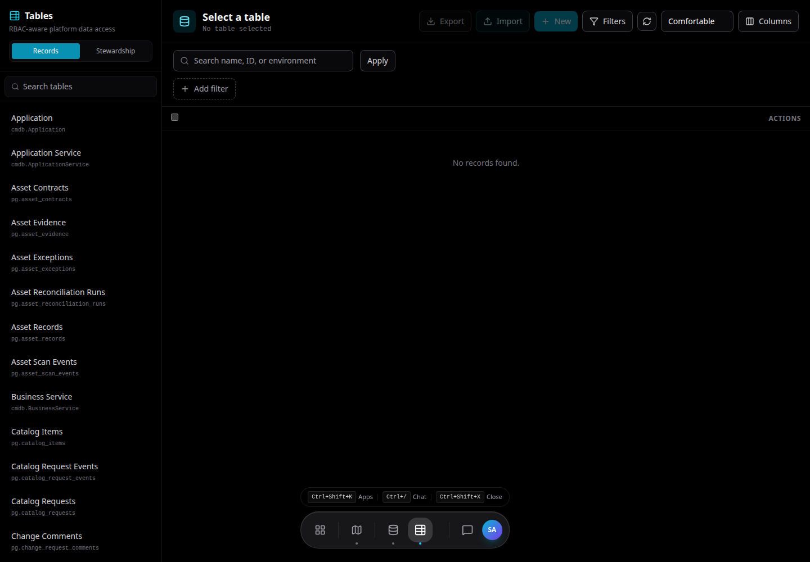
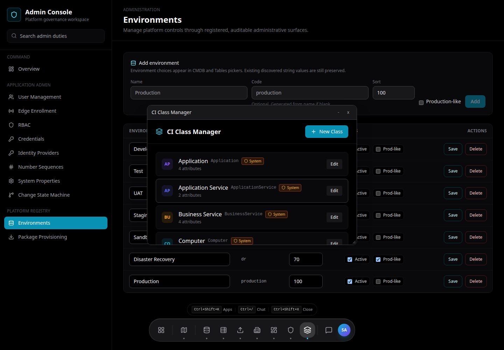
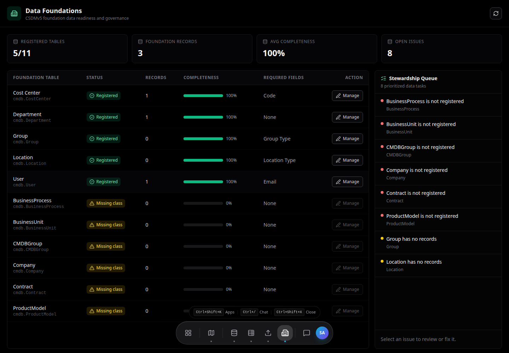

# Tables and Data Foundations

Tables provides governed record maintenance. Data Foundations provides governance for core platform data and relationship types.

## Tables

Use **Tables** to browse and maintain:

- CMDB class tables.
- Platform tables.
- ITSM records.
- Foundation data.
- Administrative support tables.

Common actions:

- Search and filter records.
- Change visible columns.
- Save views.
- Create records.
- Edit records.
- Delete records when allowed.
- Bulk update.
- Import CSV or spreadsheet data.
- Export CSV or JSON.

## Reference Fields

Reference fields use typeahead search by default.

Examples:

- Assigned User references **User** records.
- Department references **Department** records.
- Cost Center references **Cost Center** records.
- CI relationship fields reference configured CI classes.

Display values are controlled by the target class display configuration:

- Primary display field.
- Optional secondary display fields joined with ` | `.
- Fallback to known name/code fields.
- Final fallback to record id.

## Environment Picker

Environment is admin-managed reference data, not hard-coded application text.

Administrators can manage environments in **Admin Console > Environments**.

Recommended defaults:

- Production.
- Development.
- Test.
- UAT.
- Staging.
- Sandbox.

## CI Class Manager

Use **CI Class Manager** to define:

- Class name and display name.
- Parent class.
- Attributes.
- Attribute types.
- Mandatory fields.
- Health-required fields.
- Reconciliation keys.
- Reference classes.
- Enum values.
- Display field.
- Secondary display fields.

Changes affect how records appear in Tables, CMDB Explorer, Discovery preview, and reference selectors.

## Out-of-Box Classes

Specora includes core OOB classes such as:

- Business Service.
- Application Service.
- Application.
- Server.
- Computer.
- User.
- Department.
- Cost Center.
- Network Gear.

Class coverage will expand as platform packages mature.

## Data Foundations

Use **Data Foundations** to:

- Inspect foundation data quality.
- Manage relationship types.
- Review CSDM readiness signals.
- Govern foundation data before service mapping and reporting depend on it.

## Relationship Types

Administrators can create, edit, activate, deactivate, or delete relationship type options when allowed.

Relationship types should be:

- Named consistently.
- Directionally meaningful.
- Limited to values useful for impact analysis.
- Documented for discovery mapping and manual editing.

Related:

- [CMDB and Service Mapping](cmdb-and-service-mapping.md)
- [Admin Guide](../admin/README.md)
